# BlockRent – Blockchain Equipment Rental System

ระบบเช่าอุปกรณ์และจัดการเงินมัดจำด้วย Smart Contract บน **Ethereum Sepolia Testnet**
(Solidity ^0.8.20 · React + Vite · ethers v6 · MetaMask · Infura · Remix)

## ฟีเจอร์
- ลงประกาศ/แก้ไขอุปกรณ์ (ชื่อ รายละเอียด ประเภท รูป ราคา/วัน เงินมัดจำ)
- เช่าและชำระ ETH = (ราคา/วัน × จำนวนวัน) + เงินมัดจำ
- ยืนยันส่งมอบ 2 ขั้นตอน (Owner → Renter) → สถานะ Active
- แจ้งคืน / ยืนยันรับคืน / **Pull Payment** (`withdraw()`)
- เปิดข้อพิพาท และ Admin แบ่งเงินมัดจำ (ยอดรวมต้องเท่ากับเงินมัดจำ)
- ประวัติธุรกรรมจาก Blockchain Events พร้อมลิงก์ Sepolia Etherscan

## เมนูแยกตาม Role
Role ของ Admin คือ Wallet ที่ Deploy Contract

| สถานะ | เมนูที่เห็น |
|---|---|
| ยังไม่เชื่อมต่อ Wallet | ตลาดอุปกรณ์ |
| ผู้ใช้ทั่วไป | ตลาดอุปกรณ์, ลงประกาศอุปกรณ์ |
| ผู้ใช้ที่เคยลงประกาศ (Owner) | + แดชบอร์ดเจ้าของ |
| ผู้ใช้ที่เคยเช่า (Renter) | + แดชบอร์ดผู้เช่า |
| Admin | ตลาดอุปกรณ์, จัดการระบบ (ตัดสินข้อพิพาท) |

## รันเว็บไซต์
```bash
npm install
npm run dev
```

## โครงสร้างโปรเจกต์
```
contracts/EquipmentRental.sol      Smart Contract
src/blockchain/                    contract.js (Infura อ่าน / MetaMask เขียน) + ABI
src/context/WalletContext.jsx      Wallet, Role, โหลดข้อมูล, ส่งธุรกรรม
src/components/                    Navbar (เมนูตาม Role), WalletConnect, EquipmentCard, RentalStatus, TransactionHistory
src/pages/                         Home, EquipmentDetail, CreateEquipment, Owner/Renter/Admin Dashboard, RentalDetail
```

## ขั้นตอนการทำงาน

### การเช่าอุปกรณ์ตามปกติ (Normal Rental Process)

1. ลงประกาศอุปกรณ์ให้เช่า (Owner)

Owner ลงประกาศอุปกรณ์โดยกรอกข้อมูล ได้แก่ ชื่ออุปกรณ์ ประเภท รายละเอียด รูปภาพ ค่าเช่าต่อวัน และจำนวนเงินมัดจำ จากนั้นยืนยันธุรกรรมผ่าน MetaMask เพื่อเผยแพร่อุปกรณ์บนระบบ
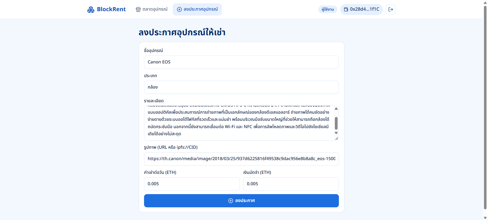

2. แก้ไขข้อมูลอุปกรณ์ (Owner)

Owner สามารถแก้ไขข้อมูลอุปกรณ์ที่ลงประกาศไว้ เช่น ราคาเช่าต่อวัน เงินมัดจำ และสถานะการเปิดให้เช่า โดยยืนยันการเปลี่ยนแปลงผ่าน MetaMask
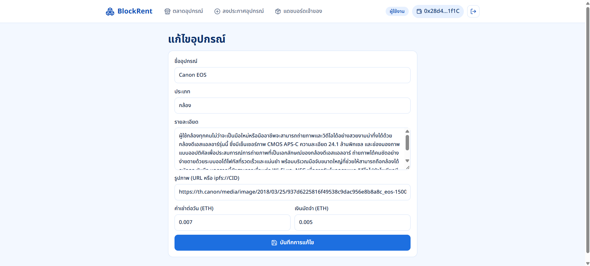

3. เลือกเช่าและชำระเงิน (Renter)

Renter เลือกอุปกรณ์ที่ต้องการเช่าและระบุจำนวนวัน ระบบจะคำนวณยอดชำระทั้งหมดโดยอัตโนมัติจากค่าเช่ารวมและเงินมัดจำ จากนั้น Renter ยืนยันการเช่าและชำระ ETH ผ่าน MetaMask โดยเงินจะถูกพักไว้ใน Smart Contract
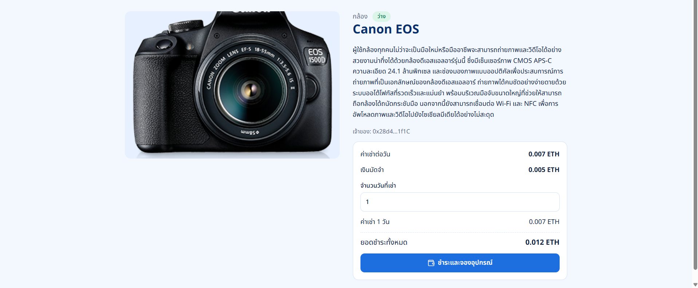
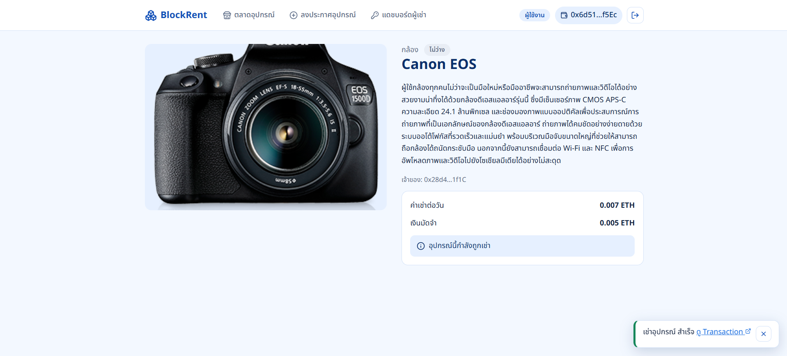

4. ยืนยันการส่งมอบอุปกรณ์ (Owner)

Owner ตรวจสอบรายละเอียดการเช่าและข้อมูล Wallet ของ Renter เมื่อส่งมอบอุปกรณ์แล้ว ให้คลิกปุ่ม ยืนยันส่งมอบ และยืนยันธุรกรรมผ่าน MetaMask
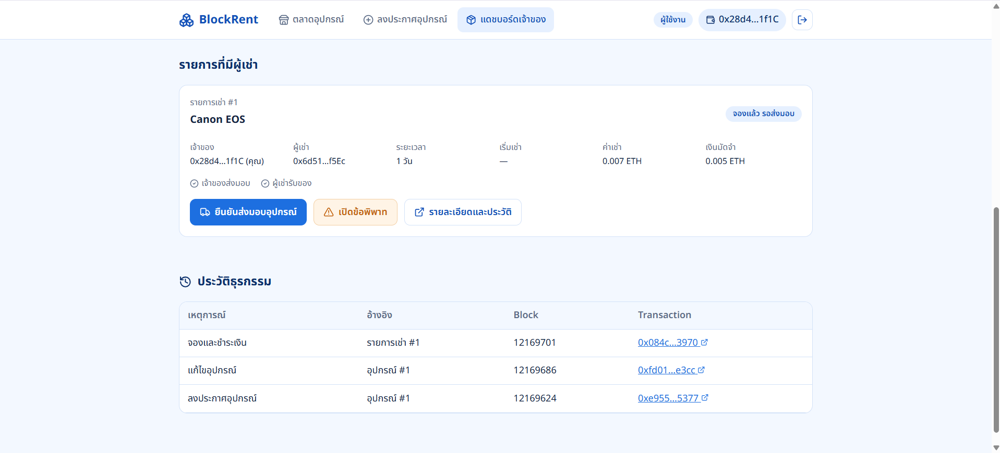
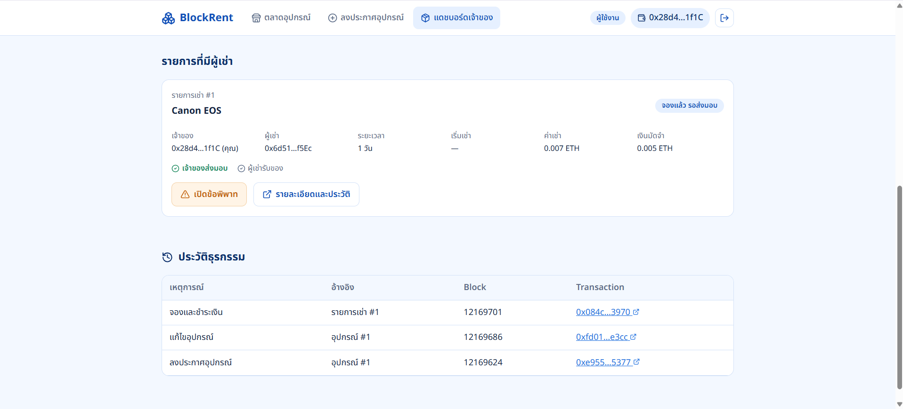

5. ยืนยันการรับอุปกรณ์ (Renter)

หลังจากได้รับอุปกรณ์ Renter คลิกปุ่ม ยืนยันรับอุปกรณ์ เพื่อยืนยันการรับมอบ โดยระบบจะเปลี่ยนสถานะการเช่าเป็น Active
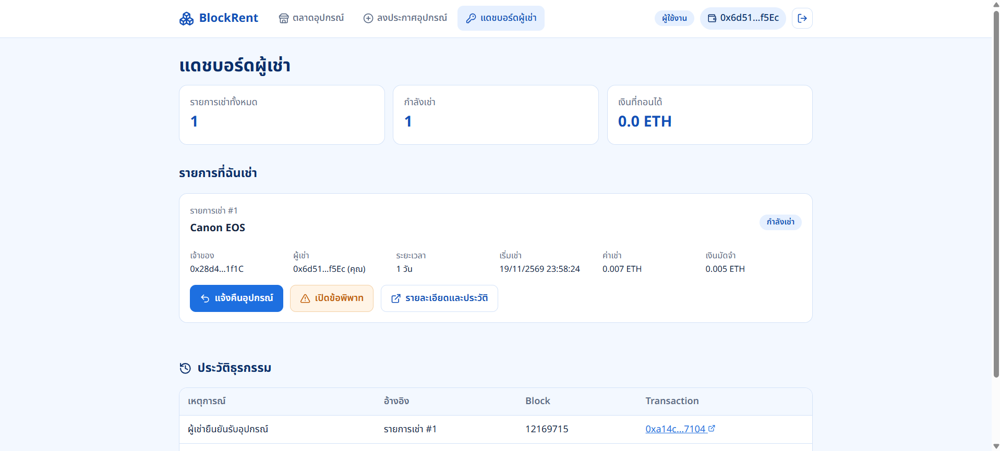

6. แจ้งคืนอุปกรณ์ (Renter)

เมื่อสิ้นสุดการใช้งาน Renter คลิกปุ่ม แจ้งคืนอุปกรณ์ ระบบจะเปลี่ยนสถานะเป็น ReturnRequested และรอให้ Owner ตรวจสอบสภาพอุปกรณ์
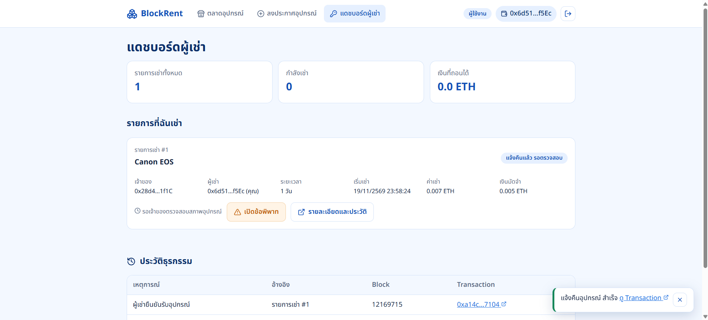

7. ยืนยันการรับคืนอุปกรณ์ (Owner)

Owner ตรวจสอบสภาพอุปกรณ์ที่ Renter ส่งคืน หากอุปกรณ์อยู่ในสภาพเรียบร้อย ให้คลิกปุ่ม ยืนยันรับคืน ระบบจะเปลี่ยนสถานะเป็น Completed และจัดสรรเงินค่าเช่าและเงินมัดจำตามเงื่อนไขของ Smart Contract
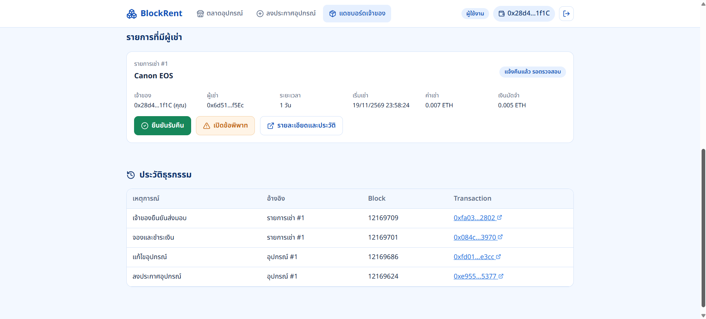

8. ถอนเงินค่าเช่าและเงินมัดจำ (Owner และ Renter)

เมื่อการเช่าเสร็จสิ้น Owner สามารถถอนเงินค่าเช่าที่ได้รับ และ Renter สามารถถอนเงินมัดจำคืนได้ผ่านปุ่ม Withdraw โดยยืนยันธุรกรรมผ่าน MetaMask
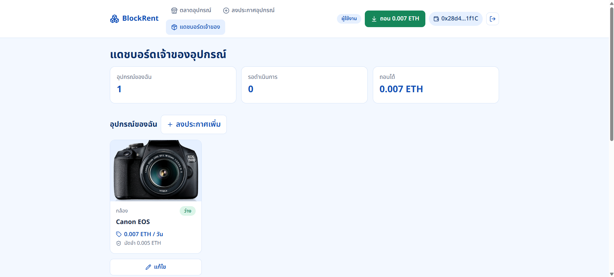
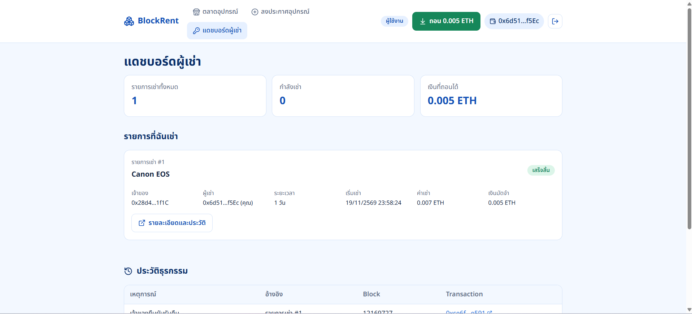

### กรณีเกิดข้อพิพาท (Dispute Management)

9. สร้างรายการเช่าใหม่สำหรับทดสอบข้อพิพาท (Owner และ Renter)

Owner ลงประกาศอุปกรณ์ชิ้นที่ 2 จากนั้น Renter ดำเนินการเช่าและชำระเงิน พร้อมยืนยันการส่งมอบและรับอุปกรณ์ตามขั้นตอนปกติ เพื่อสร้างรายการเช่าสำหรับทดสอบกรณีเกิดข้อพิพาท
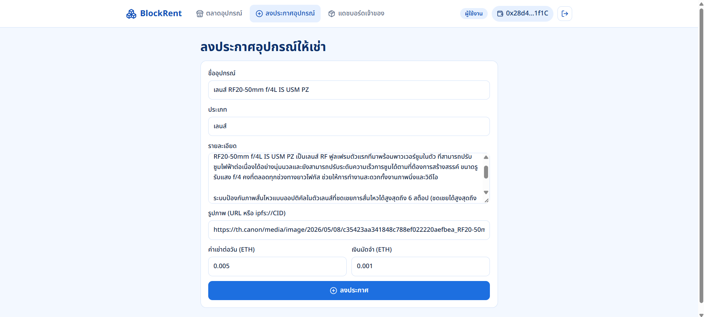

10. เปิดข้อพิพาท (Owner)

หากพบปัญหาเกี่ยวกับการเช่า เช่น อุปกรณ์ได้รับความเสียหาย Owner สามารถคลิกปุ่ม เปิดข้อพิพาท และระบุหลักฐานประกอบ เช่น Hash หรือ IPFS CID ของรูปภาพหรือเอกสาร จากนั้นยืนยันธุรกรรมผ่าน MetaMask โดยสถานะรายการจะเปลี่ยนเป็น Disputed
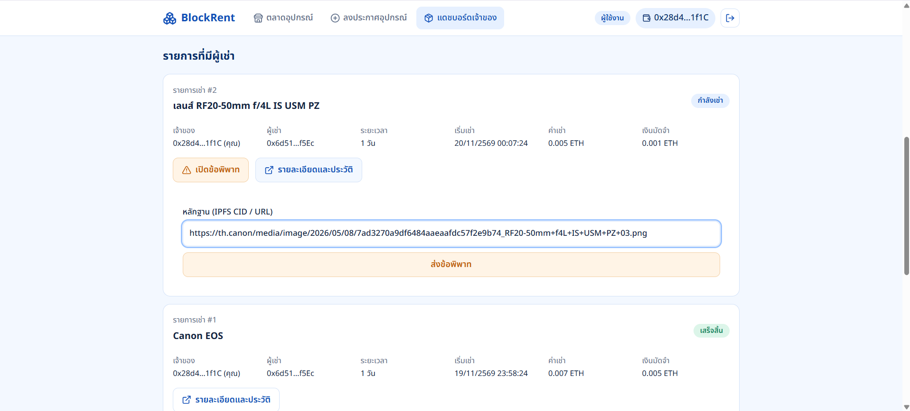
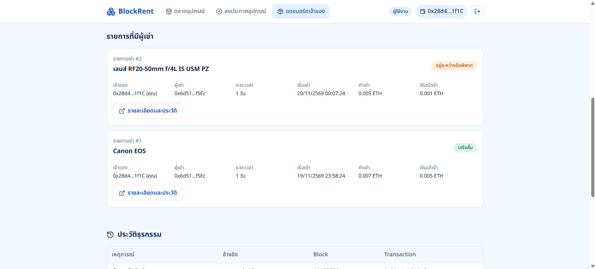

11. ตัดสินข้อพิพาท (Admin)

Admin ตรวจสอบรายละเอียดการเช่าและหลักฐานที่เกี่ยวข้อง จากนั้นกำหนดจำนวนเงินมัดจำที่จะคืนให้ Renter และจำนวนเงินชดเชยให้ Owner โดยผลรวมต้องเท่ากับเงินมัดจำทั้งหมด เมื่อคลิกปุ่ม ตัดสินข้อพิพาท และยืนยันธุรกรรมแล้ว ระบบจะเปลี่ยนสถานะเป็น Completed
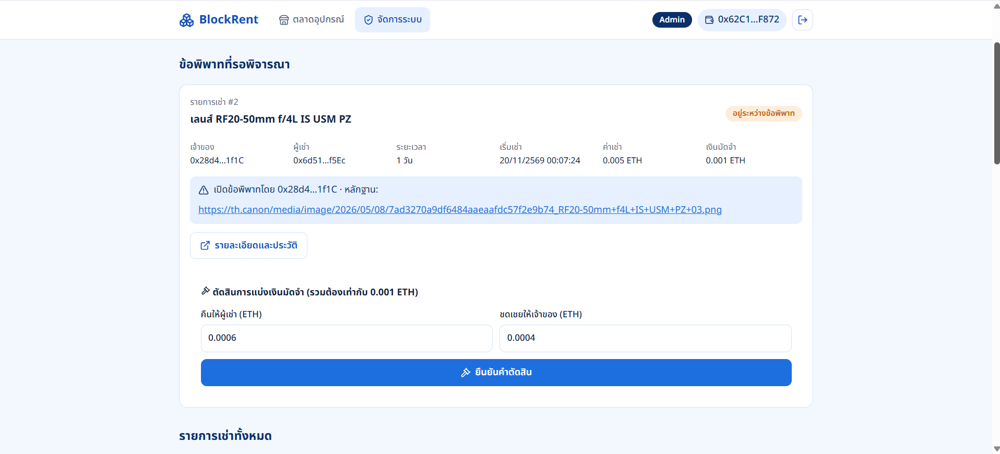

12. ถอนเงินตามผลการตัดสิน (Owner และ Renter)

หลังการตัดสินข้อพิพาท Owner และ Renter สามารถถอนเงินตามจำนวนที่ได้รับสิทธิ์ผ่าน Smart Contract โดยยืนยันธุรกรรมผ่าน MetaMask
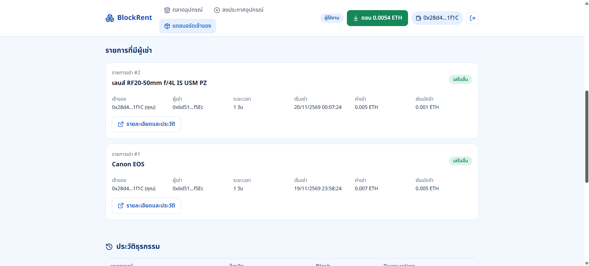

ตรวจ Transaction Hash ของทุกขั้นตอนได้ที่ https://sepolia.etherscan.io